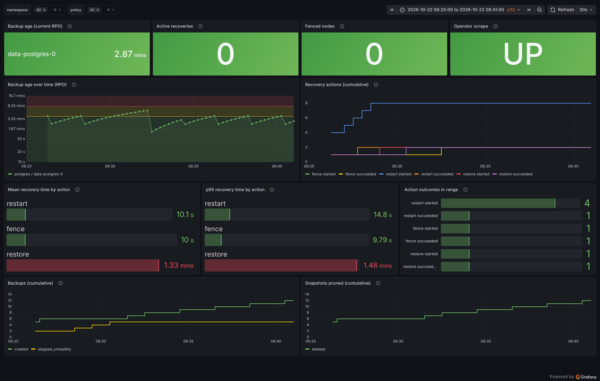
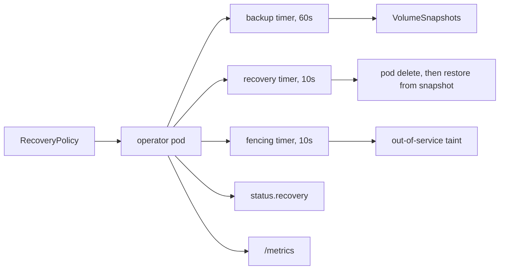

# stateful-recovery-operator

A Kopf-based Kubernetes operator. It watches a RecoveryPolicy CRD. It schedules
CSI VolumeSnapshot backups of StatefulSet PVCs. It recovers StatefulSets from
pod, node, and volume failures. It fences dead nodes with the
node.kubernetes.io/out-of-service taint.

This is a learning project. The owner writes all implementation code.

## Repository layout

- `recovery_operator/` — operator source code (Kopf handlers and helpers)
- `deploy/` — Kubernetes manifests for the operator
- `examples/` — example manifests (StatefulSet, RecoveryPolicy)
- `dashboards/` — Grafana dashboards
- `tests/unit/` — unit tests
- `tests/e2e/` — end-to-end tests against a kind cluster
- `scripts/` — helper scripts, including the STE linter
- `kind.yaml` — kind cluster config for local development

## Quick start

1. Run `make cluster` to create the kind cluster.
2. Run `make csi` to install the CSI snapshot lab.
3. Run `make nfs` to install the NFS driver and server. It provides cross-node volumes for the M4 fencing test.
4. Run `make deploy`. It builds the operator image, loads it into kind, and applies `deploy/`.
5. Run `kubectl apply -f examples/` to create the Postgres StatefulSets and their RecoveryPolicies.
6. Run `make monitoring` to install Prometheus and Grafana.

The operator runs as 1 pod on the control-plane node. A fence on a worker can't evict it. The Deployment uses the `Recreate` strategy, because a rolling update would run two operators for a short time. `make undeploy` deletes the operator and its RBAC. It keeps the CRD, because deleting the CRD deletes every RecoveryPolicy.

These are the Events from a fence test with the operator as a pod. The test stopped `recovery-lab-worker3` at 09:12:32:

```text
09:14:17Z  NodeFenced     pg-nfs  recovery-lab-worker3: fencing this node
09:14:37Z  FenceVerified  pg-nfs  recovery-lab-worker3: verified after 20s, no VolumeAttachment required
09:14:57Z  NodeUnfenced   pg-nfs  recovery-lab-worker3: taint removed
```

## After RestoreFailed

The operator does not retry a failed restore. Inspect these items before you reset:

- The snapshot named in the `RestoreFailed` event and in `status.recovery.restore.snapshot`.
- The retained old PV, if any. Its name is in `status.recovery.restore.oldPv` and it carries the annotation `recovery.iv-cmd.dev/retained-from`. It keeps the pre-restore data.
- The StatefulSet replica count. A failure in `CreatingPvc` leaves it at 0 by design.

To clear the failed state and let the operator try again:

```sh
kubectl patch rp <name> --subresource=status --type=merge -p '{"status":{"phase":"Ready","recovery":{"restore":null}}}'
```

## Observability

Run `make monitoring` to install Prometheus and Grafana in the `monitoring` namespace. Both run on the control-plane node, so a fence on a worker can't evict them. The operator serves metrics on port 8000 (`METRICS_PORT`). Prometheus scrapes the operator pod through the Service `recovery-operator-metrics.default.svc:8000`. For a local `kopf run`, run `make monitoring METRICS_TARGET=172.18.0.1:8000`. On Docker Desktop, use `METRICS_TARGET=host.docker.internal:8000` instead (untested).

The dashboard `dashboards/recovery.json` loads automatically. Port-forward `svc/grafana 3000` to open it. The screenshot shows one restart, one restore, and one fence:



Useful queries:

- `time() - backup_last_success_timestamp_seconds`: the age of the newest ready snapshot, which is the data you would lose now.
- `histogram_quantile(0.5, sum by (le, action) (rate(recovery_duration_seconds_bucket[1h])))`: the median recovery time per action.
- `sum by (action, result) (recovery_actions_total)`: the count of each recovery outcome.

## Architecture



Three Kopf timers run for each RecoveryPolicy:

- The backup timer creates a VolumeSnapshot on the cron schedule. It deletes ready snapshots past the retention count.
- The recovery timer deletes a failing pod. After `maxRestarts` deletes that do not fix the pod, it escalates. If the policy enables restore, it restores the PVC from the newest ready snapshot.
- The fencing timer adds the `node.kubernetes.io/out-of-service` taint to a dead node. It checks that the pod and its VolumeAttachments are gone. It deletes its taint when the node is Ready again.

Each timer keeps its state in its own key under `status.recovery`. A restarted operator reads that state and continues from the same step. Snapshot and PVC names are deterministic. A retried create gets a 409 and makes no second object.

## Measured recovery times

Measured on kind with the operator's `recovery_duration_seconds` histogram:

| Action | Measured from | Time |
|---|---|---|
| Pod restart | Pod delete to Ready | 10s |
| Node fence | Taint to verified | 10–20s |
| Restore | Restore start to pod Ready | 80s |

A node fence also waits about 2 minutes after the node stops: about 48s until Kubernetes marks it NotReady, then `notReadySeconds`. With backups every 2 minutes, the backup age stays below 4 minutes.

## RBAC trade-offs

The operator uses the ServiceAccount `recovery-operator` with a Role and a ClusterRole. Each rule in `deploy/rbac.yaml` names the code that needs it.

- The Role covers objects in `default`: RecoveryPolicies, StatefulSets, pods, PVCs, VolumeSnapshots, and Events. The operator can't touch pods in other namespaces.
- The ClusterRole covers cluster-scoped objects: nodes, PVs, VolumeAttachments, and CSIDrivers. A Role can't grant access to them.
- Fencing needs `update` on nodes, not `patch`. The fence reads the node, edits the taint list, and replaces the node. A merge patch would replace the whole taint list.
- Kopf needs list and watch on namespaces and CRDs at cluster scope. The pod logs showed each of these as a 403. These grants only allow reads.
- `kubectl auth can-i` checks that the operator can't delete nodes or VolumeAttachments, read Secrets, or create pods.
- The widest grant is `update` on nodes. It allows any change to a node spec, for example removing an admin taint. An admission policy could limit it to the out-of-service taint. The lab doesn't do this.

## Known limitations

- The lab proves the fencing steps and the recovery path. It doesn't prove durable storage. The NFS server runs on one node and keeps its data in memory. Real cross-node durability needs replicated storage.
- The out-of-service taint states that a node is dead. It doesn't prove it. A partitioned node can still write to the volume. Production needs out-of-band proof, such as the power state from the BMC or the cloud API.
- The operator can't detect a snapshot taken after corruption started but before the operator saw the failure. It restores that snapshot, the pod misses its ready timeout, and the operator reports `RestoreFailed`. A human must select a good snapshot.
- The operator runs as 1 replica. While its pod restarts, no backup, restart, or fence happens.
- The operator refuses to fence when more than one node is unhealthy. This rule blocks recovery when a whole rack fails.
- The tests cover restore only on a single-replica Postgres on hostpath storage.
- The operator watches only the `default` namespace.
- Prometheus keeps its data in an `emptyDir`. A control-plane restart loses the metrics history.
- CI builds an amd64 image only. On Apple silicon, `make deploy` builds a local image.

## Design questions

### Why fence instead of force-delete?

A force delete deletes the pod object from the API. It doesn't stop the container on the node. On a partitioned node, the container can keep writing to the volume. Kubernetes then starts a second pod on the same RWO volume, and two writers corrupt the data. The out-of-service taint tells Kubernetes that the node is down. Kubernetes then deletes the pods and detaches their volumes. The operator checks that the pod and the VolumeAttachments are gone before it reports `FenceVerified`.

### What if the node is only partitioned?

The taint doesn't stop a partitioned node, so Postgres there can keep writing. The operator lowers this risk with strict rules:

- Fencing is opt-in for each policy.
- The node must be NotReady for `notReadySeconds`.
- Kubernetes must have added its `unreachable` taint.
- Only one node can be unhealthy, and it can't be the control-plane node.

Production needs real fencing first. Power off the node through the BMC or the cloud API, then add the taint.

### How does the operator limit the blast radius?

- RBAC grants only the verbs the code calls. See "RBAC trade-offs".
- `dryRun` is on by default. Fencing and restore are opt-in.
- A restore tests the snapshot in a throwaway PVC before it changes the real PVC.
- A restore sets the old PV to `Retain` before it deletes the PVC, so the old data stays.
- The operator never retries a failed restore on its own.

### What are the recovery time and the RPO?

See "Measured recovery times". With `notReadySeconds: 60`, the fence came about 1m45s after the node stopped. The pod was Ready about 16s after the fence. The configured RPO is the backup interval. `time() - backup_last_success_timestamp_seconds` shows the actual RPO. With backups every 2 minutes, it stays below 4 minutes.

### How does this scale to 15,000 nodes?

- Each timer lists all nodes, PVs, and VolumeAttachments every 10 seconds for each policy. At 15,000 nodes, that loads the API server. Use watches with a local cache, such as Kopf indexes or informers.
- The rule "refuse when more than one node is unhealthy" fails at that size, because some nodes are always down. Use a rate limit and a threshold for each zone instead, like the node lifecycle controller.
- One operator pod becomes a bottleneck. Shard the policies by namespace, with one active replica for each shard.
- Snapshots need a limit for each storage backend, so that backups don't overload the storage.
